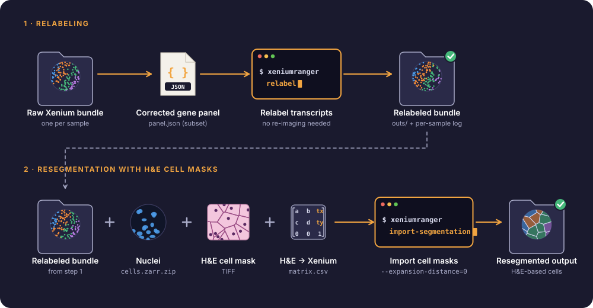

# Medicago Xenium Relabeling and Resegmentation

**Xenium Ranger pipelines for transcript relabeling and H&E-based cell resegmentation of *Medicago truncatula* root nodule spatial transcriptomics data**

[](https://doi.org/10.64898/2026.06.23.733685)


[](LICENSE)
[](https://doi.org/10.5281/zenodo.24095590)

This repository contains the batch scripts used to process the Xenium *in situ* datasets in:

> **Jhu M-Y**\*, Heffer J, Xia C, Moraes TA, Mulvey CM, Bressan D, Liu C, Gao JP, Poole P, Schiessl K, Oldroyd G\* (2026). 4D spatial transcriptomics reveals nodule identity emerges through stacked parallel developmental programs. *bioRxiv*. [doi:10.64898/2026.06.23.733685](https://doi.org/10.64898/2026.06.23.733685)

Raw Xenium output bundles go through two steps:

1. **Relabeling:** each bundle is relabeled with the gene panel used in this study (`xeniumranger relabel`). No re-imaging is needed.
2. **Resegmentation:** cell boundaries from H&E-derived cell masks are imported into the relabeled bundle, together with the Xenium nuclei and an H&E-to-Xenium coordinate transform (`xeniumranger import-segmentation`).

<p align="center">
  
</p>

## Datasets and gene panels

Four Xenium experiments are processed, each in its own folder. Two pilots were used to optimize the workflow and validate the experimental conditions; the other two are the datasets analyzed in the manuscript.

| Folder | Gene panel | Species | Role | H&E resegmentation |
|---|---|---|---|---|
| `Mt_50_gene_panel` | 50-gene *Medicago* panel | *M. truncatula* | Pilot: first test of plant spatial transcriptomics | – |
| `Mt_50+rhizobia_50_gene_panel` | 50-gene *Medicago* + 50-gene rhizobia add-on | *M. truncatula* + *S. meliloti* 2011 | Pilot: first dual-species test | ✓ |
| `Mt_350+55_gene_panel` | 405-gene *Medicago* panel (350 + 55 add-on) | *M. truncatula* | Manuscript dataset | ✓ |
| `Mt_350+rhizobia_50_gene_panel` | 400-gene panel (350 *Medicago* + 50 rhizobia) | *M. truncatula* + *S. meliloti* 2011 | Manuscript dataset | ✓ |

Raw data are deposited in NCBI (see the Data Availability statement of the paper).

## Repository folder structure

```text
.
├── README.md
├── LICENSE
├── CITATION.cff              # citation metadata (GitHub "Cite this repository")
├── assets/
│   ├── workflow.svg
│   └── make_workflow.py      # reproducible figure generator
├── relabeling/
│   ├── Mt_50_gene_panel/
│   │   └── run_relabel_50g.sh
│   ├── Mt_350+55_gene_panel/
│   │   └── run_relabel_405.sh
│   ├── Mt_50+rhizobia_50_gene_panel/
│   │   └── run_relabel_rhizobia_50+50.sh
│   └── Mt_350+rhizobia_50_gene_panel/
│       └── run_relabel_rhizobia_50+380_focused_panel.sh
└── resegmentation/
    ├── HnE_Mt_350+55_gene_panel/
    │   └── run_import_HE_405.sh
    ├── HnE_Mt_50+rhizobia_50_gene_panel/
    │   └── run_import_HE_rhizobia_50plus50_20260312.sh
    └── HnE_Mt_350+rhizobia_50_gene_panel/
        └── run_import_HE_rhizobia_50plus380_400gene_20260312.sh
```

## General requirements

These scripts are Bash scripts and assume they are run on the processing system where the referenced Xenium data directories exist.

Required command-line tools:

- `bash`
- [`xeniumranger`](https://www.10xgenomics.com/support/software/xenium-ranger/latest) (version 4.0.1.1)
- `jq`
- `sha256sum` for most relabeling scripts
- standard Unix tools such as `find`, `sed`, `awk`, `sort`, `tee`, and `mkdir`

Resource settings used across the scripts:

- `CORES=12`
- `MEM=24`

Before running, point the scripts to your data. Every path is built from one setting, `XENIUM_ROOT` (default placeholder: `/path/to/Xenium`), and each individual path, `CORES` and `MEM` can also be overridden from the environment without editing the script:

```bash
XENIUM_ROOT=/data/my_xenium_project bash relabeling/Mt_50_gene_panel/run_relabel_50g.sh
CORES=24 MEM=64 XENIUM_ROOT=/data/my_xenium_project bash relabeling/Mt_50_gene_panel/run_relabel_50g.sh
```

The folder layout expected under `XENIUM_ROOT` (`raw_outputs/`, `subset_panel/`, `relabeled/`, `inputs/`, `segmentation_output/`) is shown in each script's configuration block.

## Relabeling scripts

Relabeling scripts use `xeniumranger relabel` to replace or subset the panel metadata of raw Xenium bundles. In general, each script:

1. Defines a panel JSON, raw bundle directory, output root, logs directory, compute resources, and sample list or bundle-discovery rule.
2. Verifies required tools and input paths.
3. Optionally verifies the panel JSON checksum by comparing `.metadata.sha256_checksum` against a checksum computed from `.payload`.
4. Locates each raw Xenium bundle by sample ID.
5. Skips samples whose output already contains an `outs/` directory.
6. Runs `xeniumranger relabel` and writes a per-sample log.
7. Copies the exact panel JSON used into `_panel_used/gene_panel.json` for provenance in most relabeling batches.


## Resegmentation / H&E import scripts

Resegmentation scripts use `xeniumranger import-segmentation` to import externally generated H&E cell masks into relabeled Xenium bundles. In general, each script:

1. Defines the relabeled Xenium output root, expected output suffix, H&E mask root, H&E transformation matrix root, output root, log directory, and compute settings.
2. Auto-discovers samples from relabeled output folders.
3. For each sample, locates:
   - relabeled bundle `outs/` directory,
   - nuclei file: `cells.zarr.zip` from the relabeled bundle,
   - H&E cell mask: `H&E_<sample>.ome_mask.tif`,
   - coordinate transform matrix: `H&E_<sample>_alignment_files/matrix.csv`.
4. Skips samples with missing required inputs.
5. Skips existing outputs unless `FORCE=1` is set in the environment.
6. Runs `xeniumranger import-segmentation` with `--units=pixels` and `--expansion-distance=0`.
7. Writes per-sample logs and reports run/skip counts.

## How to run

Run scripts from the repository root or from any location by passing the script path to Bash:

```bash
bash relabeling/Mt_50_gene_panel/run_relabel_50g.sh
bash relabeling/Mt_350+55_gene_panel/run_relabel_405.sh
bash relabeling/Mt_50+rhizobia_50_gene_panel/run_relabel_rhizobia_50+50.sh
bash relabeling/Mt_350+rhizobia_50_gene_panel/run_relabel_rhizobia_50+380_focused_panel.sh

bash resegmentation/HnE_Mt_350+55_gene_panel/run_import_HE_405.sh
bash resegmentation/HnE_Mt_50+rhizobia_50_gene_panel/run_import_HE_rhizobia_50plus50_20260312.sh
bash resegmentation/HnE_Mt_350+rhizobia_50_gene_panel/run_import_HE_rhizobia_50plus380_400gene_20260312.sh
```

To force a resegmentation rerun and overwrite an existing output folder, set `FORCE=1` for the relevant import script:

```bash
FORCE=1 bash resegmentation/HnE_Mt_50+rhizobia_50_gene_panel/run_import_HE_rhizobia_50plus50_20260312.sh
```

## Related repositories

- [Medicago_Rhizobia_Xenium_Analysis_Workflow](https://github.com/MinYaoJhu/Medicago_Rhizobia_Xenium_Analysis_Workflow): downstream analysis of the relabeled and resegmented data
- [MedicagoXeniumSpatialViewer](https://github.com/MinYaoJhu/MedicagoXeniumSpatialViewer): interactive Shiny app for exploring Xenium data
- [Xenium_data_analysis_training](https://github.com/MinYaoJhu/Xenium_data_analysis_training): a 4-week training program on Xenium data analysis

## Citation

If you use these scripts, please cite the preprint above and the archived code: Jhu M-Y (2026). *Medicago Xenium Relabeling and Resegmentation* (v1.0.0). Zenodo. [doi:10.5281/zenodo.24095590](https://doi.org/10.5281/zenodo.24095590). GitHub's **"Cite this repository"** button (from [`CITATION.cff`](CITATION.cff)) gives the citation in APA and BibTeX formats.

## AI assistance

Code refactoring, documentation and figures in this repository were developed with the assistance of Claude Opus 5.5 (Anthropic), used through Claude Code. All changes were directed, reviewed and approved by the author, who takes full responsibility for the content.

## Contact

**Min-Yao Jhu**, Senior Research Scientist  
Donald Danforth Plant Science Center  
Email: [MJhu@danforthcenter.org](mailto:MJhu@danforthcenter.org)